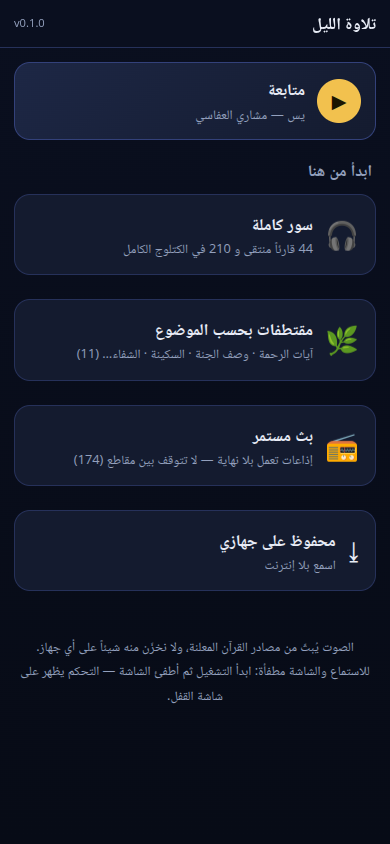
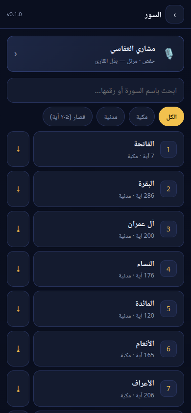
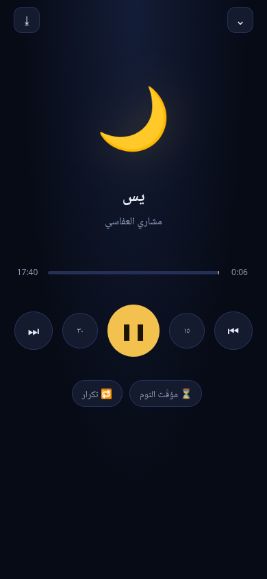
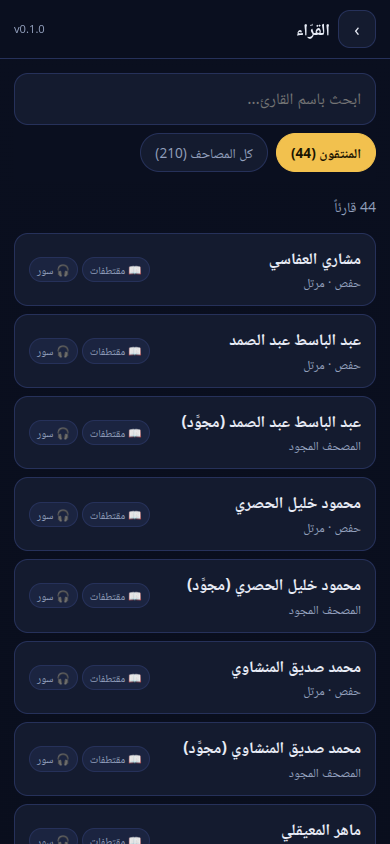

# 🌙 تلاوة الليل (quran-night)

**مشغّل تلاوات القرآن قبل النوم** — تطبيق ويب (PWA) يُثبَّت على جوال أندرويد ويعمل **في الخلفية والشاشة مطفأة**، فيه **سور كاملة** و**مقتطفات بحسب الموضوع** (آيات الرحمة · وصف الجنة · السكينة · الشفاء…) و**إذاعات مستمرة** لا تتوقف، مع **مؤقّت نوم** بتلاشٍ تدريجي.

**بلا سيرفر · بلا حساب · بلا إعلانات · وبلا تخزين للصوت عند أي جهة** — الصوت يُبثّ مباشرة من مصادره المعلنة.

### ▶️ يعمل الآن على: **https://afkw2aziz-cmyk.github.io/quran-night/**

> افتحه من كروم على أندرويد ← ⋮ ← «تثبيت التطبيق». (التفاصيل في §التثبيت أدناه.)

[](CHANGELOG.md)
[](LICENSE)
[](package.json)

<p align="center">
  
  
  
  
</p>

---

## ⚡ التثبيت على الجوال (مرة واحدة)

1. افتح رابط التطبيق في **كروم** على أندرويد.
2. القائمة ⋮ ← **«تثبيت التطبيق»** أو **«إضافة إلى الشاشة الرئيسية»**.
3. افتحه من الأيقونة، ثم في الإعدادات الأولى اختر ما يناسبك.
4. **للتشغيل والشاشة مطفأة:** يعمل التطبيق فعلاً في الخلفية (يتحكّم من إشعار القفل). لكن أندرويد
   يقتل التطبيقات الموفِّرة للبطارية، فإن توقّف الصوت بعد دقائق:
   **الإعدادات ← التطبيقات ← كروم ← البطارية ← «غير مقيَّد»** (وأوقف توفير الطاقة للنظام إن لزم).

> التثبيت يحتاج الرابط **HTTPS** (وهو ما توفّره GitHub Pages تلقائياً) — فلا يُثبَّت من `file://` أو `http://`.

---

## 1) المزايا

| ما تريد | عندك |
|---|---|
| سور كاملة | **٢١٠ مصحفاً** في الكتلوج الكامل · و**٤٤ قارئاً منتقى** للاستعمال اليومي |
| مقتطفات بحسب الموضوع | **١١ موضوعاً** (٥١٨ آية بين مقتطفات وسور): آيات الرحمة · وصف الجنة · السكينة · الليل والنوم · الصبر · الاستغفار · الدعاء · الشفاء · الشكر · قصار السور · سور مختارة للّيل |
| روايات متعدّدة | حفص · ورش · قالون · الدوري · المجوَّد — مع تمييز اسم الرواية في القائمة |
| بثٌّ لا يتوقّف | **~١٧٠ إذاعة** قرآنية متواصلة (مناسبة للنوم: لا تنقطع لنهاية سورة) |
| تشغيل في الخلفية | يستمرّ والشاشة مطفأة، وبلوحة تحكّم على **شاشة القفل** (اسم القارئ والسورة) |
| مؤقّت نوم | ١٠ / ٢٠ / ٣٠ / ٤٥ / ٦٠ / ٩٠ دقيقة — مع **تلاشٍ تدريجي** في آخر ٢٠ ثانية |
| خيارات إضافية | «توقّف عند نهاية المقطع» · «تكرار» · إرجاع ١٥ ثانية / تقديم ٣٠ ثانية |
| متابعة من حيث توقفت | بطاقة «متابعة» في الرئيسية تستأنف آخر سورة من موضعها |
| بلا إنترنت | حفظ أي سورة أو مقتطف **على جهازك أنت** (IndexedDB) للاستماع بلا شبكة |
| بحث وتصفية | بحث باسم القارئ أو السورة، وتصفية: الكل / مكية / مدنية / قصار (≤٢٠ آية) |

---

## 2) كيف يعمل (بلا سيرفر)

```
        جوالك                                    الإنترنت
   ┌───────────────┐                    ┌───────────────────────────┐
   │  تلاوة الليل   │  طلب ملف الصوت    │  mp3quran.net             │
   │  (صفحة ثابتة)  │ ─────────────────▶ │  everyayah.com            │
   │               │                    │  إذاعات Shoutcast         │
   └───────────────┘                    └───────────────────────────┘
        ▲                                            │
        │  ملفات صغيرة ثابتة (JSON)                   │
        └──────────── GitHub Pages ──────────────────┘
```

* **لا سيرفر لنا إطلاقاً**: التطبيق صفحة ثابتة + ملفات بيانات صغيرة. لا شيء يُرفع من جوالك.
* **الصوت لا يُنسخ عندنا**: الروابط تُبنى في جوالك وتُطلب مباشرة من مصدرها الأصلي.
* **مجلّد العمل يُخزَّن مؤقتاً في المتصفح** (Service Worker) ليفتح التطبيق بلا شبكة، أما الصوت
  فلا يُخزَّن إلا إذا ضغطت ⤓ بنفسك.

---

## 3) المصادر (كل رابط مُتحقَّق منه)

| المصدر | ما يُؤخذ منه |
|---|---|
| [mp3quran.net](https://mp3quran.net/api/v3) | المصاحف الكاملة + الإذاعات المستمرة |
| [everyayah.com](https://everyayah.com/data/) | التلاوة **آية بآية** (وهي أساس المقتطفات) |
| [quran.com v4](https://api.quran.com/api/v4/chapters) | أسماء السور وعدد آياتها (٦٢٣٦ آية محقّقة) |

> عند بناء الكتلوج **لا يُكتب أي رابط قبل أن يُفحص فعلياً** على الشبكة: تُجرَّب السور
> ١ و٥٥ و١١٤ من كل مصحف، وتُستبعد المصاحف التعليمية (المصحف المعلِّم) والتعليمية-المترجمة.
> لذلك قد يتغيّر عدد المصاحف والإذاعات قليلاً بين بناء وآخر — وهذا مقصود: العدد المُعلن
> هو **المتحقَّق منه الآن**، لا كل ما في المصدر.

---

## 4) المقتطفات — مختارات اجتهادية

المقتطفات (آيات الرحمة، وصف الجنة، السكينة…) هي **اختيار بشري (اجتهاد)** وليست من مصدر
وحيَ بترتيبها؛ فلكل عالم وباحث اختياره. لهذا:

* كل موضوع معلَّم داخل التطبيق بأنه «مختارات اجتهادية لا قائمة شرعية متّفق عليها».
* نصوص المواضيع ونطاقاتها معروضة كاملة في **[TOPICS.md](TOPICS.md)** لمراجعتها واعتمادها أو تعديلها.
* لتعديل موضوع: حرّر `tools/topics.draft.json` ثم `npm run build`.

---

## 5) الاستعمال اليومي

| ما تريد | كيف |
|---|---|
| تشغيل سورة | «سور كاملة» ← اختر قارئاً ← السورة (تشغيل فوري وتستمرّ بعده) |
| مقتطف سريع | «مقتطفات بحسب الموضوع» ← الموضوع ← المقطوعة |
| نوم بلا انقطاع | «بث مستمر» ← إذاعة (لا تنتهي بنهاية سورة) |
| إيقاف تلقائي | في المشغّل: ⏳ مؤقّت النوم ← المدة |
| بلا إنترنت | في المشغّل: ⤓ (أو زر ⤓ بجانب السورة) ← انتظر انتهاء التحميل |
| إدارة المحفوظ | الرئيسية ← «محفوظ على جهازي» (يعرض المساحة، ويحذف ما تريد) |

**شرح الأزرار في المشغّل:** ⏮ السابق · ١٥ إرجاع ١٥ ثانية · ⏸ تشغيل/إيقاف · ٣٠ تقديم ٣٠ ثانية · ⏭ التالي · ⏳ مؤقّت النوم · 🔁 تكرار · ⤓ حفظ · ⌄ إغلاق.

---

## 6) التشغيل محلياً

المتطلبات: **Node.js ≥ 20** (لبناء البيانات) و**Python 3** (سيرفر تجربة بسيط). لا اعتماديات npm إطلاقاً.

```bash
git clone https://github.com/afkw2aziz-cmyk/quran-night.git
cd quran-night
npm start                     # سيرفر محلي على http://127.0.0.1:8123
```

ثم افتح `http://127.0.0.1:8123` في المتصفح. أثناء التطوير استعمل
`http://127.0.0.1:8123/?dev=1` — تُلغي تسجيل الـ Service Worker وتُفرّغ الكاش، فتظهر
تعديلاتك فوراً بلا تحديث إصدار.

> **ملاحظة مهمة:** المشغّل يستخدم Service Worker بكاش مسمّى بالإصدار
> (`qn-shell-<version>`)، فلو عدّلت ملفات الواجهة في الإنتاج فلن تظهر حتى **ترفع رقم
> الإصدار** (أو تستعمل `?dev=1`).

---

## 7) الأوامر وبناء البيانات

```bash
npm start        # تشغيل محلي (Python http.server على المنفذ 8123)
npm run build    # إعادة بناء كل البيانات: السور + المصاحف + الإذاعات + المقتطفات (يحتاج إنترنت)
npm run icons    # توليد الأيقونات (Python خالص — بلا أي مكتبة خارجية)
npm test         # ٢٦ فحصاً: سلامة البيانات + الإصدار + الملفات + الأسرار
npm test -- --net  # إضافة فحص شبكي حقيقي لروابط صوت فعليّة
```

`npm run build` هو أداة **تحقّق قبل الكتابة**: يجرّب كل رابط، ويستبعد ما لا يعمل، ثم يكتب
`data/*.json` و`version.json`. فإذا مات مصدر أو تغيّر رابط، يكفيك إعادة البناء لتُصلَح الروابط.

---

## 8) بنية المشروع

```
quran-night/
├── index.html                 واجهة التطبيق (عربي RTL بالكامل)
├── css/style.css              التنسيق (ليلي، متجاوب، بلا مكتبات)
├── js/app.js                  الواجهة والتوجيه والبحث وبناء الطوابير
├── js/player.js               المشغّل: طابور، خلفية، شاشة القفل، مؤقّت نوم، تكرار
├── js/offline.js              الحفظ على الجهاز (IndexedDB) مع شريط تقدّم
├── js/store.js                التفضيلات وآخر موضع تشغيل (localStorage)
├── sw.js                      Service Worker: كاش الواجهة المسمّى بالإصدار
├── data/                      بيانات مولَّدة (لا تُحرَّر يدوياً)
│   ├── surahs.json            ١١٤ سورة و٦٢٣٦ آية
│   ├── reciters.json          المنتقون (٤٤) + الكتلوج الكامل (٢١٠)
│   ├── topics.json            ١١ موضوعاً بإحداثيات آياتها
│   └── radios.json            الإذاعات المستمرة المتحقَّق منها
├── tools/
│   ├── build-catalog.mjs      يبني السور والمصاحف والإذاعات مع التحقق
│   ├── build-topics.mjs       يتحقق من نطاقات المقتطفات ويكتب TOPICS.md
│   ├── topics.draft.json      مصدر المقتطفات (حرّره هنا)
│   ├── reciters.map.json      خريطة القرّاء المنتقين ومصادرهم
│   ├── make-icons.py          توليد الأيقونات (بايثون خالص)
│   └── verify.mjs             اختبار المشروع كاملاً (`npm test`)
├── assets/                    الأيقونات (مولَّدة بـ npm run icons)
├── docs/                      لقطات الشاشة المستعملة في هذا الملف
├── TOPICS.md                  ورقة مراجعة المقتطفات بنصوصها الكاملة
├── CHANGELOG.md               سجل الإصدارات
└── version.json               نسخة الواجهة (مشتقّة من package.json عند البناء)
```

---

## 9) النشر على GitHub Pages

1. أنشئ مستودعاً **عامّاً** باسم `quran-night` وارفع إليه المشروع.
2. من المستودع: **Settings ← Pages ← Source: Deploy from a branch ← Branch: `main` / `(root)`**.
3. افتح `https://<username>.github.io/quran-night/` على جوالك وثبّته.

> كل المسارات **نسبية** (`./data/…`, `sw.js`) والـ`scope` نسبي، فيعمل التطبيق من أي
> مجلّد فرعي بلا تعديل. ولا يحتاج GitHub Actions — النشر من الفرع مباشرة.

---

## 10) الإصدارات

رقم الإصدار له **مصدر واحد فقط**: حقل `version` في `package.json`.

| أين يظهر | كيف |
|---|---|
| أعلى شاشة التطبيق | يُقرأ من `version.json` |
| اسم كاش الـ Service Worker | `qn-shell-<version>` في `sw.js` |
| شارة أعلى هذه الصفحة | تقرأها shields.io من آخر `git tag` |

`npm test` يفشل إن اختلف `package.json` و`version.json` و`sw.js` — فلا يمكن أن تنشر
إصداراً متناقضاً. سجل التغييرات وقواعد الترقية في [CHANGELOG.md](CHANGELOG.md).

---

## 11) حدود معروفة (اقرأها بصدق)

1. **البثّ يحتاج إنترنت.** «محفوظ على جهازي» هو الحلّ الوحيد بلا شبكة، ولذلك احفظ ما تحبّ
   سماعه مسبقاً إن كان الإنترنت في غرفتك ينقطع ليلاً.
2. **صوت فقط — بلا نص آيات على الشاشة** (وهذا اختيار مقصود: الاستماع قبل النوم). لا تنتظر
   مصحفاً مرئياً.
3. **المقتطفات اجتهادية** لا شرعية متّفق عليها (انظر §٤ و[TOPICS.md](TOPICS.md)).
4. **مواقيت الآيات غير متاحة** من المصادر المتاحة، فلا يوجد «انتقال إلى الآية الفلانية» داخل
   سورة كاملة. المقتطفات مبنيّة على مقاطع جاهزة **آية بآية**، ولهذا تعمل بضغطة واحدة.
5. **مصدر الصوت قد يتعطّل.** إذا لم يعمل قارئ، أعد `npm run build`؛ فأداة البناء تفحص
   المصادر وتستبعد المتعطّل منها.
6. **الإذاعات الشعبية** (Shoutcast) قد تنقطع لحظة، ويعيد التطبيق المحاولة تلقائياً — إن طال
   الانقطاع فبدّل الإذاعة.
7. **آيفون**: تشغيل الصوت في الخلفية غير موثوق في PWA على iOS (قيد في WebKit). هذا التطبيق
   مبنيّ ومُختبَر لأندرويد، ويُفتح على iOS لكن بلا ضمان للخلفية.
8. **السماء ليست دائمة**: الصفحة مستضافة على GitHub Pages، والمصادر على mp3quran/everyayah —
   أي انقطاعٍ عندهم يوقف الصوت حتى يعود (والتطبيق نفسه يبقى يعمل من الكاش).

---

## 12) الخصوصية

* لا حسابات، لا تسجيل، لا تحليلات، لا إعلانات، ولا كوكيز تتبّع.
* لا يُرسل شيء من جهازك إلى أي جهة — لا إلى مطوّر التطبيق ولا لغيره.
* ما تحفظه بـ⤓ يبقى **في جهازك**، ويُحذف من زر واحد في «محفوظ على جهازي».
* التفضيلات وآخر موضع تشغيل تُحفظ في `localStorage` على جهازك فقط.

---

## الرخصة

[MIT](LICENSE) — استعمله وطوّره كما تشاء.

> النص القرآني والتلاوات مِلك عام للأمة، ولا يُخزَّن منها شيء في هذا المستودع — البيانات هنا
> أسماءٌ وأرقامٌ وروابط، والتلاوة تُبثّ مباشرة من مصدرها.
